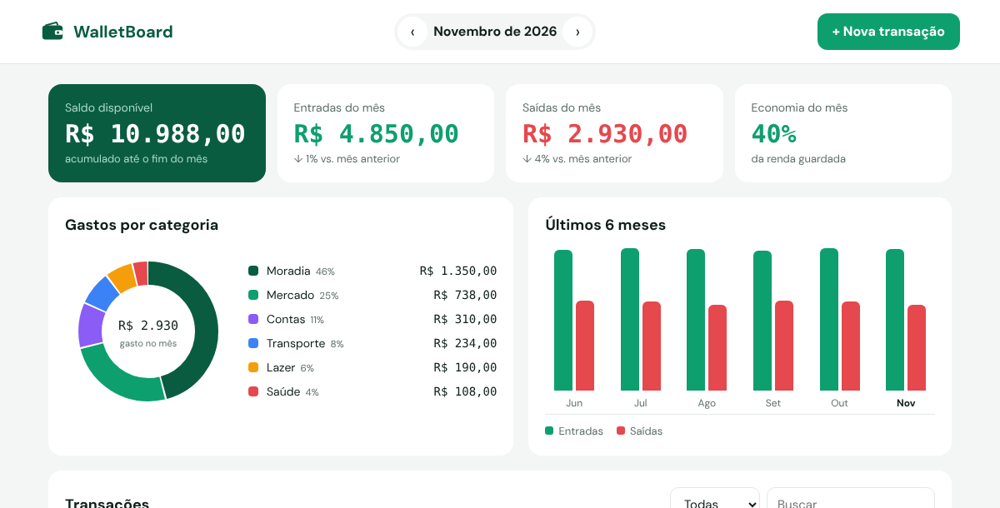

# WalletBoard — Controle financeiro

Painel de finanças pessoais: registre entradas e saídas, veja seus gastos por categoria e acompanhe o saldo disponível.

🔗 **[Ver o site no ar](https://iamviniciuslima05.github.io/PROJETO-WalletBoard/)**



## Funcionalidades

- Cadastro de **entradas e saídas** com valor, descrição, categoria e data
- Cards de **saldo disponível**, entradas, saídas e **% de economia** do mês
- Comparação com o **mês anterior**
- **Gráfico de rosca** com os gastos por categoria
- **Gráfico de barras** dos últimos 6 meses
- Navegação entre meses, filtro por tipo e busca
- Gráficos feitos em **SVG e CSS puros**, sem bibliotecas
- Dados salvos no **localStorage** (vem com exemplos na primeira visita)

## Tecnologias

HTML5 · CSS3 · JavaScript · SVG · localStorage

## Estrutura

```
index.html
css/style.css
js/script.js
```

## Como rodar

Não precisa instalar nada: baixe o projeto e abra o `index.html` no navegador, ou acesse a versão publicada acima.

---
Feito por **Vinicius Lima** · [Portfólio](https://viniciuslimadev.netlify.app) · [LinkedIn](https://www.linkedin.com/in/viniciuslima25/)
